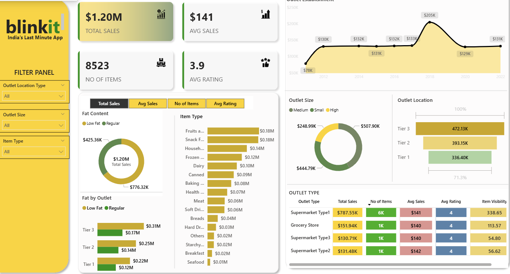

# Blinkit Sales Analysis Dashboard | Power BI

## Project Overview

This project presents an interactive sales analysis dashboard for Blinkit, India's last-minute delivery app, developed using Microsoft Power BI.

The dashboard provides a visual analysis of sales performance, product categories, item characteristics and outlet-level metrics. It enables users to explore business data through interactive visualisations and filters.

## Project Objectives

- Analyse overall sales performance using key business metrics.
- Examine sales distribution across different item categories.
- Understand the contribution of different outlet sizes and location types.
- Explore sales trends based on outlet establishment year.
- Provide an interactive dashboard for business data exploration.

## Tools & Technologies

- Microsoft Power BI
- Data Visualisation
- Business Data Analysis

## Dashboard Features

### 1. Key Performance Indicators (KPIs)
- Total Sales
- Average Sales
- Number of Items
- Average Rating

### 2. Sales Analysis
- Sales distribution by Item Fat Content.
- Sales by Item Type.
- Sales comparison across Outlet Location Types.
- Sales trends by Outlet Establishment Year.

### 3. Outlet Analysis
- Sales distribution by Outlet Size.
- Outlet Location Type analysis.
- Outlet-level performance using a pivot table.

### 4. Interactive Filters
- Metrics selection
- Outlet Location Type
- Outlet Size
- Item Type

## Dashboard Preview

## Project File

The original Power BI project file (.pbix) is available in this repository.

Download the file and open it using Microsoft Power BI Desktop to explore the report and its interactive features.

## Key Learnings

- Creating interactive dashboards using Power BI.
- Designing KPI cards and data visualisations.
- Exploring sales and outlet-level business metrics.
- Using slicers for dynamic data exploration.
- Presenting business information through visual storytelling.

---

**Project:** Blinkit Sales Analysis Dashboard  
**Tool:** Microsoft Power BI  
**Created by:** Anjali Gupta
